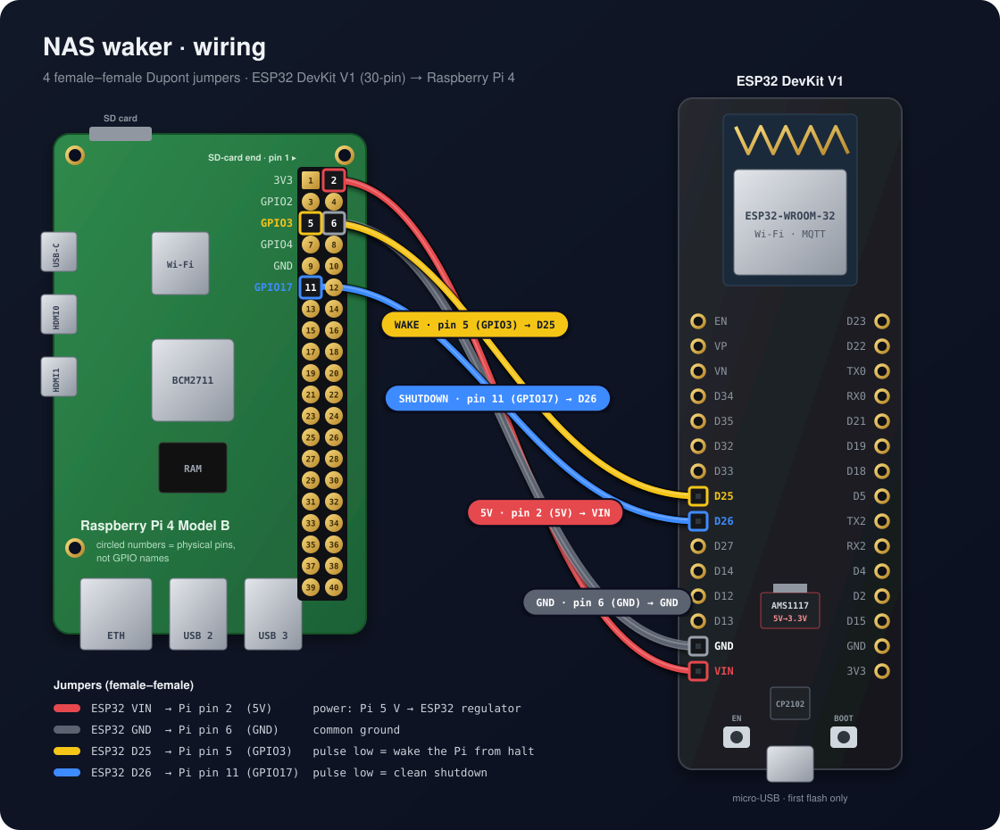
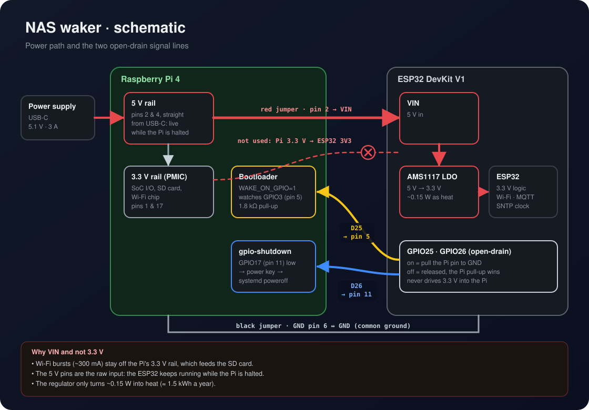

# nas-waker

A Raspberry Pi 4 home NAS that is only on when it is needed, woken by an ESP32.

- **Films over DLNA**: MiniDLNA shares an NTFS USB disk (TVs, Freebox, VLC).
- **Nightly backups over FTP**: vsftpd, one jailed account, plain FTP on the LAN.
- **Backups in the Finder**: an SMB share of the same folder, with the same account.
- **Power schedule**: a Nidoo flow presses *Wake NAS* at 22:45 and *Shut down NAS* at 23:15 every night. The ESP32 has no schedule of its own.
- **Nidoo integration**: the ESP32 publishes Home Assistant MQTT discovery, so [Nidoo](https://github.com/Gekkotron/Nidoo) shows *Wake NAS* and *Shut down NAS* with no Nidoo change.



## Layout

| Path | What |
|---|---|
| `esp32/nas-waker.yaml` | ESPHome firmware for the waker |
| `esp32/secrets.example.yaml` | Template for `esp32/secrets.yaml` (git-ignored) |
| `pi/setup-nas.sh` | Idempotent installer for everything on the Pi |
| `docs/draw.py` | Draws `docs/wiring.svg` and `docs/schematic.svg` (`python3 docs/draw.py`) |

## Wiring

Four female–female Dupont jumpers, no other parts. Both boards use 3.3 V logic, and the ESP32 outputs are open-drain: they only ever pull a Pi pin to ground, and the Pi's pull-ups do the rest.

| Jumper | ESP32 DevKit (printed label) | Raspberry Pi 4 (physical pin) | Role |
|---|---|---|---|
| red | VIN | pin 2 (5V) | powers the ESP32 |
| black | GND | pin 6 (GND) | common ground |
| yellow | D25 | pin 5 (GPIO3) | pulse low: wake from halt |
| blue | D26 | pin 11 (GPIO17) | pulse low: clean shutdown |

**Pi pin numbers are physical positions (1–40), not GPIO names.** Pin 5 is the signal GPIO3, and pin 11 is the signal GPIO17. They are not "GPIO 5" (pin 29) or "GPIO 11" (pin 23). To find them:

- **Pin 1** is the corner pin at the SD-card end, in the row towards the middle of the board.
- **Odd pins (1, 3, 5, …)** are in that inner row. **Even pins (2, 4, 6, …)** are in the row along the board edge.
- So pin 5 is the 3rd pin of the inner row, and pin 11 is the 6th.

The board doesn't print the numbers; count the rows from the SD-card end. Every 40-pin Pi (B+, 2, 3, 4, 5) has the same layout. The [official pinout](https://www.raspberrypi.com/documentation/computers/raspberry-pi.html#gpio) shows both numberings.

On a 38-pin ESP32-DevKitC, `VIN` is printed `5V`, and D25 / D26 may read `25` / `26` or `IO25` / `IO26`.

> [!WARNING]
> Disconnect the 5V wire while the ESP32 is plugged into a computer over USB, or USB power feeds into the Pi.
> Also power the ESP32 before connecting D26: an unpowered ESP32 can drag its pins towards ground, which the Pi may read as a shutdown request.

### Power: why VIN and not the Pi's 3.3 V



Feeding the Pi's 3.3 V pin straight into the ESP32's 3V3 pin would skip the DevKit's AMS1117 regulator, but VIN is the better choice:

1. **It protects the Pi.** The Pi's 3.3 V rail also feeds its SoC I/O, the SD card and the Wi-Fi chip. The ESP32 draws 80–120 mA on average, with bursts of about 300 mA each time it transmits. On VIN, those bursts come from the 3 A power supply instead of the rail the SD card depends on.
2. **It keeps the ESP32 alive whatever the Pi does.** The 5 V pins are the raw USB-C input, live whenever the power is plugged in. The 3.3 V rail is switched by the Pi's power chip. It stays on while the Pi is halted only because `WAKE_ON_GPIO=1`. With `POWER_OFF_ON_HALT=1` it would go off, and the ESP32 could never wake the Pi again.
3. **The saving is tiny.** The regulator turns 1.7 V × ~0.1 A ≈ 0.15–0.2 W into heat, about 1.5 kWh a year.

To cut the ESP32's power use anyway:

- **Wi-Fi power saving is already on.** ESPHome defaults to `power_save_mode: light` on the ESP32. `high` would save a little more but adds latency to MQTT commands; it isn't worth it here.
- **Fit a small 5 V → 3.3 V switching regulator** fed from pin 2, driving the 3V3 pin. That keeps both benefits at about 90% efficiency.
- **Never power the 3V3 pin while USB is connected.** Two regulators would then fight over the same rail.

## Pi setup

Raspberry Pi OS (Debian 13 trixie), user `nas` (uid 1000), the bootloader at its default `WAKE_ON_GPIO=1`.

Edit the settings block at the top of `pi/setup-nas.sh` (the disk UUID from `blkid`, and the folders to share), then:

```sh
scp -r pi nas@192.168.1.131:
ssh nas@192.168.1.131
sudo FTP_PASS='choose-a-password' ./pi/setup-nas.sh   # first install
sudo ./pi/setup-nas.sh                               # later runs keep the FTP password
sudo ./pi/setup-nas.sh --rescan                      # also rebuild the DLNA index
```

The script:

- mounts the disk at `/mnt/films` with the in-kernel `ntfs3` driver (`nofail`, so the Pi still boots without it);
- installs MiniDLNA ("NAS Films", status page on port 8200) and vsftpd (account `ftpbackup`, jailed in `/mnt/films/Backups`, passive ports 40000–40100);
- installs Samba: one share, `Backups`, for the same folder and the same account (SMB2+ only, no guest, macOS `.DS_Store` / `._*` files blocked), announced over mDNS as **NAS**;
- installs the nightly auto-shutdown;
- adds `dtoverlay=gpio-shutdown,gpio_pin=17` to `/boot/firmware/config.txt`.

It keeps `.orig` copies of the config files it replaces.

### Backups: FTP for the software, SMB for you

- **FTP**: `192.168.1.131`, port 21, user `ftpbackup`, plain FTP, passive mode. The account is jailed in the disk's `Backups` folder, so a client's `/` is `Backups/`. A remote path of `/backups/Accounting` lands in `Backups/backups/Accounting/` on the disk.
- **SMB**: in the Finder, *Go → Connect to Server* (⌘K) → `smb://192.168.1.131/Backups`, same user and password. It also appears in the sidebar as **NAS**. Use it to browse, copy and delete.
- **Don't use the Finder's own FTP support** (`ftp://…` in ⌘K). It is read-only, and it caches the folder listing, so new backups don't appear until you eject and reconnect.
- **Schedule nightly backups between 22:50 and 23:05.** The Pi starts at 22:45 and needs about a minute before FTP accepts connections. At 23:15 it shuts down even if an upload is still running.

### Nightly schedule (Nidoo flow)

The flow **NAS : sauvegarde nocturne** in Nidoo has two schedule triggers, each driving one command card:

| Cron | Card |
|---|---|
| `45 22 * * *` | press `ESPbuttonwake_nas` |
| `15 23 * * *` | press `ESPbuttonshut_down_nas` |

Change the times or switch the flow off in Nidoo; nothing on the Pi or the ESP32 needs to change. The shutdown is the same clean `poweroff` as the button: it doesn't wait for transfers. Older installs had a `nightly-autoshutdown` timer on the Pi; `setup-nas.sh` now removes it.

## ESP32 firmware

```sh
cd esp32
cp secrets.example.yaml secrets.yaml      # then fill it in
uvx esphome==2026.10.2 run nas-waker.yaml --device /dev/cu.usbserial-0001   # first flash, over USB
uvx esphome==2026.10.2 run nas-waker.yaml --device nas-waker.local          # every later update, over Wi-Fi
uvx esphome==2026.10.2 logs nas-waker.yaml --device nas-waker.local         # logs only
uvx esphome==2026.10.2 dashboard .                                          # web UI on http://localhost:6052
```

Keep `ota_password` in `secrets.yaml`: without it the next update has to go over USB. Keep ESPHome at the same pinned version as the Nidoo satellites.

What the firmware does:

- **NAS online**: polls `http://192.168.1.131:8200/` every 30 s (offline after 90 s without an answer).
- **Wake NAS / Shut down NAS** buttons pulse the wake / shutdown lines.

### In Nidoo

The ESP32 publishes discovery under `homeassistant/` on the broker Nidoo reads, so these appear under the device **NAS waker**:

| Entity | Kind |
|---|---|
| `ESPbuttonwake_nas` | button |
| `ESPbuttonshut_down_nas` | button |
| `ESPsensorwifi_signal` | sensor (dBm) |
| `ESPbinary_sensornas_online` | binary_sensor (connectivity), hidden in Nidoo |

**To see whether the NAS is up, use a Nidoo network watch** (ping) on `192.168.1.131`, attached to the NAS waker device. It reacts within one ping interval (10–600 s, 30 s by default), and goes green as soon as the Pi's network is up.

The ESP32's own *NAS online* is deliberately slow: it polls the DLNA page every 30 s and waits 90 s before reporting offline, so it takes up to about 2 minutes. It's hidden in Nidoo.

## Notes

- **Shut down before unplugging the disk.** An NTFS volume removed while mounted comes back read-only; repair it with `sudo ntfsfix /dev/sda1` or `chkdsk` on Windows.
- **ntfs3 stores Linux owners on the disk.** A folder created by root stays `root:755` despite the `uid=` mount option, so `setup-nas.sh` runs `chown` on `Backups/`.
- **ESPHome 2026.10.2**: a template binary sensor needs `trigger_on_initial_state: true`, or its first state is never sent to MQTT.
- **Plain FTP is unencrypted.** Never forward port 21 or 445 on the router.
- **The Pi's journal is kept in RAM.** After a reboot, look at the disk instead: a dirty NTFS volume mounts read-only, and `dmesg | grep EXT4` shows a journal replay after an unclean shutdown.
